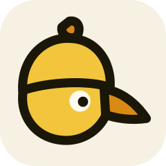

<div align="center">



# Crowsnest

**A lookout for what you install.**

Crowsnest checks the packages in your software project and gives each one a plain call:
**Clear**, **Watch** or **Hold**. A Hold means stop and check before you install or keep it.

[](LICENSE)
[](#status)
[](CONTRIBUTING.md)

[Quickstart](#quickstart) · [Ways to use it](#ways-to-use-it) · [Documentation](#documentation) · [Contributing](#contributing)
<br />

https://github.com/user-attachments/assets/06878a30-0f78-436d-9f65-570ae450abc4

<sub>A 1-minute look at what Crowsnest does. The package names in the film are made up.</sub>

</div>

---

## What is Crowsnest?

Crowsnest runs on your own computer. It reads your project's lockfile, looks at each package and at the people who
publish it, and tells you which ones look wrong before they reach production. There is no account to make, and it
works without any API keys.

Nib, the small crow in the logo, keeps watch from the masthead and rings the bell when something looks wrong.

Most scanners check your packages against a list of known problems. Crowsnest also watches for the ones that are too
new to be on a list:

- A publisher who suddenly changes, or build files that change right after a long quiet spell. That is how accounts
  get hijacked.
- A name one typo away from a popular package.
- A name an AI assistant made up, which someone may have registered since.
- One account publishing dozens of packages within minutes, the way a worm spreads.
- A package that looks clean and then misbehaves once it is installed.

Every finding comes as a call: the word, what happened in one sentence, and what to do next.

```text
Hold. quikrequest is six days old and almost nobody uses it.
```

<sub>quikrequest is a made-up package.</sub>

Crowsnest is not a replacement for a vulnerability scanner such as Dependabot or Snyk. Keep both.

## Quickstart

You need [Node.js](https://nodejs.org) 20 or newer, and [Docker](https://www.docker.com/products/docker-desktop/) to run
the backend.

```bash
npm install -g @crowsnest/cli
crowsnest start                 # first run downloads the backend, about 430 MB
crowsnest scan .                # check the project in this folder
```

`crowsnest start` runs the backend in Docker and shares the current folder with it, read only. It listens on this
machine and nowhere else. `crowsnest stop` stops it. If something is off, `crowsnest doctor` says what and how to fix
it.

Install with `-g`. Without it npm leaves the command in the current folder, where your shell will not find it.

No Docker yet? `crowsnest install <package>` and `crowsnest check` still work. They fall back to a quick check against
the public malware list, and they tell you when they have.

### Want the dashboard?

The dashboard comes with the Docker Compose setup, which builds both images from this repository:

```bash
git clone https://github.com/devampatel03/Crowsnest.git
cd Crowsnest
cp .env.example .env        # every key inside is optional
docker compose -f infra/docker-compose.yml up --build
```

The first run builds two images, so give it a few minutes. Then open **http://localhost:3000**, press **Scan a
project**, and enter the folder you want checked. To see whether the service is up, open http://localhost:8000/health.
To stop it, run `docker compose -f infra/docker-compose.yml down`.

Prefer to run it from source on macOS, Linux or Windows? See
[Installation](https://crowsnest.co.in/docs/installation).

## Ways to use it

| | What it does | Where to start |
|---|---|---|
| **Dashboard** | Horizon (what needs attention now), Lookout (the people who publish your packages), Installed (everything your project uses) and Log (every call Crowsnest has made). | [Dashboard guide](https://crowsnest.co.in/docs/dashboard) |
| **Terminal** | Scan a project, check one package, see who else is affected, replay an earlier day, and install through a check that stops a risky `npm install` before it runs. | [Command line guide](https://crowsnest.co.in/docs/cli) |
| **VS Code** | A mark on the import line of a risky package while you type. Get it from the [Marketplace](https://marketplace.visualstudio.com/items?itemName=crowsnest.crowsnest-vscode). | [VS Code guide](https://crowsnest.co.in/docs/integrations/vscode) |
| **Slack** | Alerts in a channel you choose, and four slash commands such as `/crowsnest-scan`. | [Slack guide](https://crowsnest.co.in/docs/integrations/slack) |

Crowsnest reads `package-lock.json`, `pnpm-lock.yaml`, `yarn.lock`, `poetry.lock`, `Cargo.lock` and `go.sum`.

## Optional keys

Crowsnest starts and works with none of these. Each one adds a little.

| Key | What it adds |
|---|---|
| `ANTHROPIC_API_KEY` (or the key for OpenAI, Gemini, Groq, Ollama and others) | Explanations written with an AI model's help. Without one, fixed rules write them. Pick a provider with `python -m packages.core.llm setup`. |
| `GITHUB_TOKEN`, `GITHUB_ORG` | Repository and publisher details, with higher rate limits. |
| `SOCKET_API_KEY` | Live threat alerts from Socket. |
| `NPM_TOKEN` | Signed-in requests to the npm registry. |

The [Configuration](https://crowsnest.co.in/docs/configuration) page lists what each key sends and where. With no key,
Crowsnest falls back to saved data instead of failing.

Your lockfiles stay on your machine. The `/privacy` page in the dashboard lists which package names get looked up, and
where. To remove everything Crowsnest has stored, stop it and delete `crowsnest.duckdb` and the `snapshots/` folder.

## What Crowsnest does not do

- It does not stop you from forcing an install. It warns, and the decision stays with you.
- It cannot catch an attack that has left no public trace yet. It tends to catch the next wave, once the same actor
  publishes again.
- It does not replace scanning for known CVEs. Use both.

## Documentation

The full guides are at [crowsnest.co.in/docs](https://crowsnest.co.in/docs). Their source is in
`packages/dashboard/content/docs`.

[Introduction](https://crowsnest.co.in/docs) ·
[Quickstart](https://crowsnest.co.in/docs/quickstart) ·
[Installation](https://crowsnest.co.in/docs/installation) ·
[Command line](https://crowsnest.co.in/docs/cli) ·
[Using the dashboard](https://crowsnest.co.in/docs/dashboard) ·
[Configuration](https://crowsnest.co.in/docs/configuration) ·
[FAQ](https://crowsnest.co.in/docs/faq) ·
[Troubleshooting](https://crowsnest.co.in/docs/troubleshooting)

## Status

Crowsnest is at version **0.1.0**. It works today, and the API is young enough that it may change between minor
versions.

What is out there: `@crowsnest/cli` is on [npm](https://www.npmjs.com/package/@crowsnest/cli), the extension is on the
[Marketplace](https://marketplace.visualstudio.com/items?itemName=crowsnest.crowsnest-vscode), and the backend image is
`ghcr.io/devampatel03/crowsnest-api`. The Slack bot is not published yet. It runs from this repository.

## Contributing

Crowsnest is open source and contributions are welcome: bug reports that come with a lockfile that reproduces the
problem, new detection ideas, documentation fixes and code. Read [CONTRIBUTING.md](CONTRIBUTING.md) before you open a
pull request.
### For contributors: how the repository is laid out

| Path | What lives there |
|---|---|
| `packages/core` | The Python service (FastAPI): lockfile readers, the data layer on embedded DuckDB, the detection queries and the analysis pipeline. Managed with `pip`, not part of the pnpm workspace. |
| `packages/dashboard` | The Next.js app: public site, docs and blog (`content/`), and the console. |
| `packages/cli` | The terminal command (`commander`). |
| `packages/slack-bot` | The Slack bot (`@slack/bolt`, Socket Mode). |
| `packages/vscode-extension` | The editor extension. |
| `infra` | Docker Compose file and the service Dockerfile. |

Run the service from source:

```bash
python -m venv .venv
source .venv/bin/activate            # Windows: .venv\Scripts\activate
pip install -e .
uvicorn packages.core.api:app --port 8000 --reload
```

Run the dashboard and its checks:

```bash
cd packages/dashboard
pnpm install
pnpm run dev           # http://localhost:3000
pnpm run typecheck
pnpm run lint
pnpm run test
```

Two things worth knowing before you change the core: the data file allows one read-write connection
at a time, and every query the analysis step writes is checked against a block-list of write
operations. Please keep both rules when you add a query.

## License

[Apache 2.0](LICENSE).
